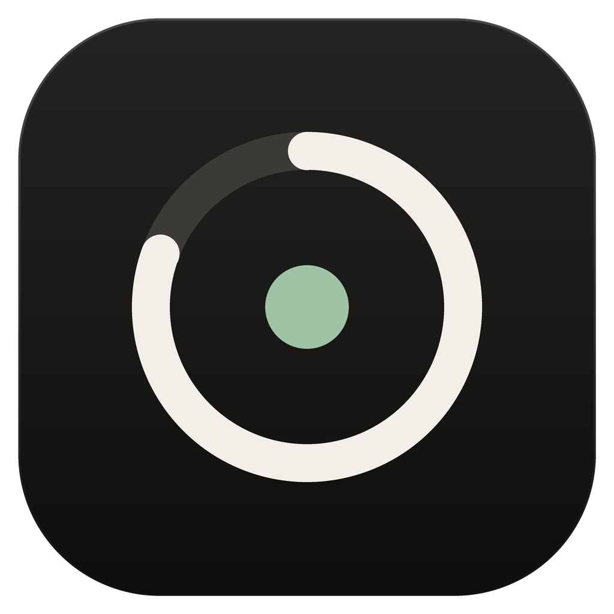
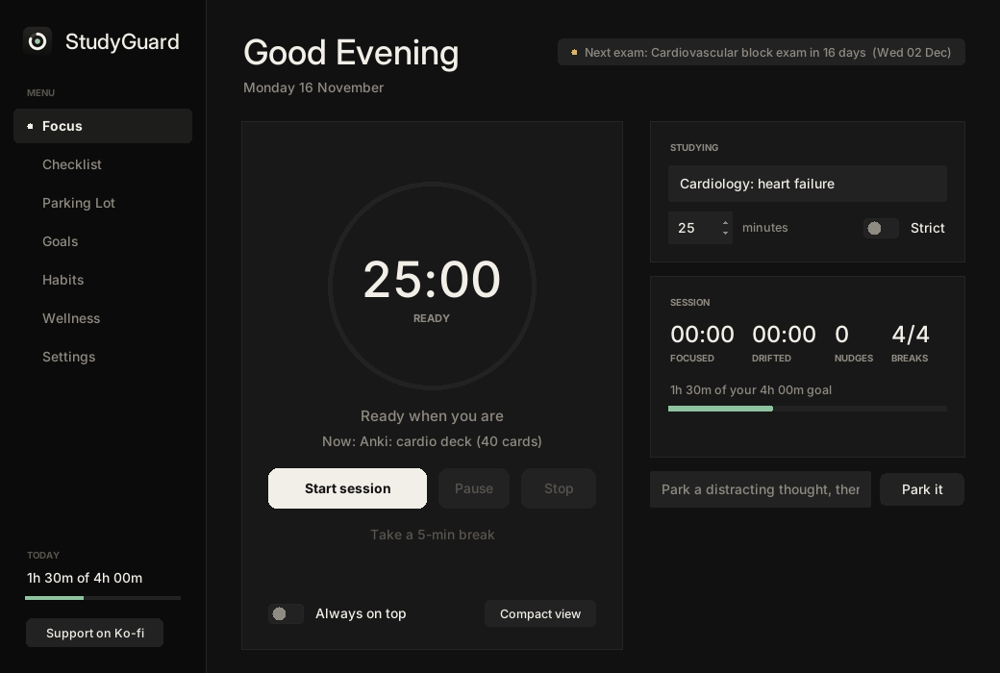
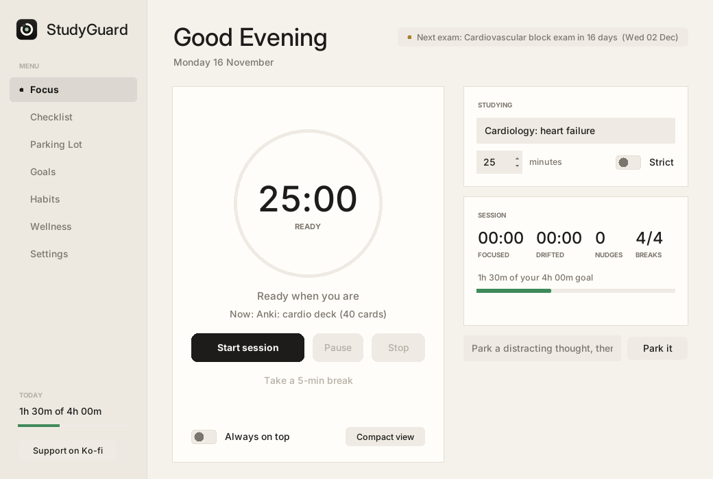
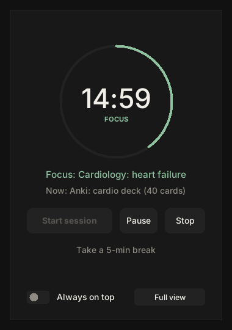
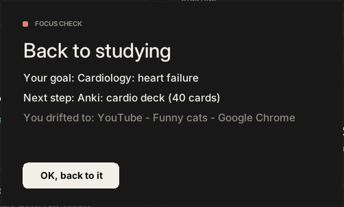

<p align="center">
  
</p>

<h1 align="center">StudyGuard</h1>

<p align="center">
  A free, private focus timer for Windows that gently pulls you back when you drift.<br>
  Built by a medical student with ADHD, for anyone who studies.
</p>

<p align="center">
  <a href="../../releases/latest"><b>⬇ Download for Windows</b></a> ·
  <a href="https://ko-fi.com/gigagoose79218">☕ Support on Ko-fi</a>
</p>



## What it does

- **Focus timer:** start a session and StudyGuard watches which window you're using. Drift to YouTube, Reddit or TikTok for too long and a pop-up nudges you back to work.
- **Strict mode:** anything that isn't a study app counts as a distraction.
- **Breaks:** up to four 5-minute breaks per hour, so you rest without losing the whole afternoon.
- **Session checklist:** break work into small steps; the next one is always shown as "Now".
- **Parking lot:** jot down stray thoughts in tabs to deal with later, and export them as `.txt`.
- **Goals:** a daily focus target with a streak, plus an exam and deadline countdown.
- **Habits:** see how much time you spend in each app or website, focused or drifting, with hourly, daily or weekly reports.
- **Wellness reminders:** water, movement and meals.
- **Compact view and always on top:** shrink to a small timer while you study.
- **Dark and light themes.**

| Light mode | Compact view | Reminder |
|---|---|---|
|  |  |  |

## Download and install

1. Go to [**Releases**](../../releases/latest) and download `StudyGuard_Windows.zip`.
2. Right-click the zip, choose **Extract All…**, then double-click `StudyGuard.exe`.
3. Windows may show **"Windows protected your PC"**, because the app isn't code-signed (it's a free solo project). Click **More info → Run anyway**.

There's nothing to install. To remove it, delete the `.exe` and the folder `C:\Users\<you>\.studyguard`.

## Privacy

- StudyGuard reads the **title of the window you're using** so it can tell if you're on a distracting site.
- **Everything stays on your computer.** Your settings, notes and habit reports are saved in `C:\Users\<you>\.studyguard`.
- **Nothing is uploaded or sent anywhere,** and there's no account, no tracking and no ads.
- The only time it touches the internet is if you click the Ko-fi button, which opens your browser.
- You can turn habit tracking off, or record app names only, in the **Habits** page.

## Run or build it yourself

You need Python 3.8+ (with tkinter, which is included in the python.org installer). It uses no other packages.

```
python studyguard.py
```

To build your own `StudyGuard.exe`, double-click `BUILD_StudyGuard.bat`. It installs PyInstaller and builds from `StudyGuard.spec`.

## Support

StudyGuard is free. If it helps you study and you can afford it, you can [buy me a coffee on Ko-fi](https://ko-fi.com/gigagoose79218). Thank you!

Found a bug or have an idea? [Open an issue](../../issues).
